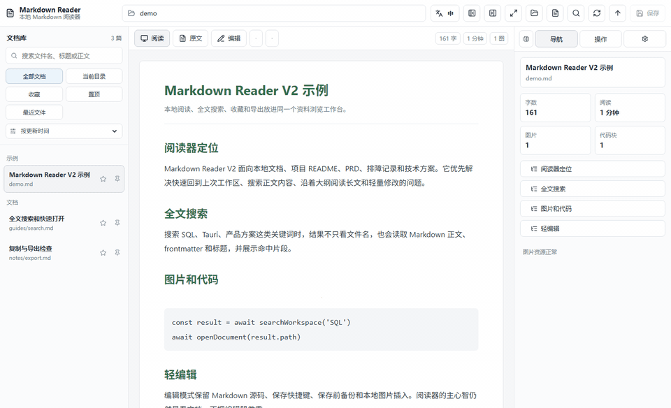
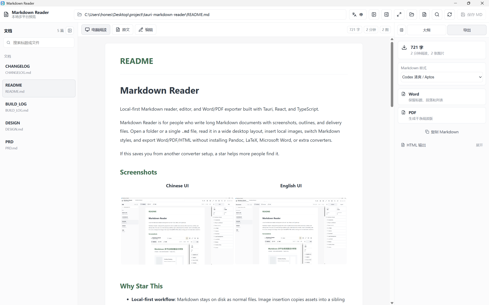
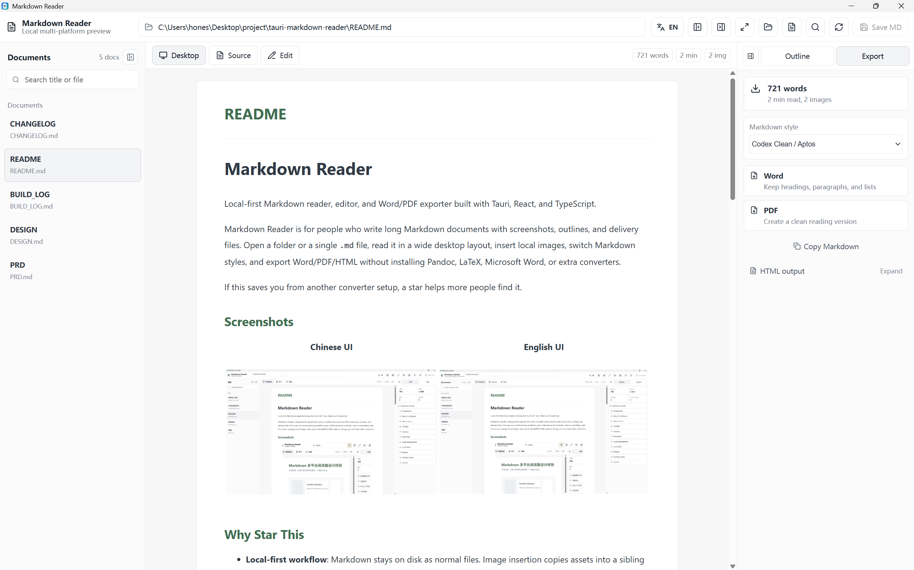

<div align="center">

<picture>
  <source media="(prefers-color-scheme: dark)" srcset="docs/assets/hero.svg">
  
</picture>

**Make project Markdown easy to find, read, and deliver.**

Open a local folder, search and read your docs, make light edits, and export to Word or PDF. Your files stay on disk.

**Who it’s for:** Developers and teams working with READMEs, technical plans, product docs, and meeting notes.

[App releases](https://github.com/honestTai/tauri-markdown-reader/releases) · [GitHub](https://github.com/honestTai/tauri-markdown-reader) · [HRouter](https://hrouter.net/home)

**[Quick start](#-quick-start) · [Features](#-features) · [Docs](#-docs) · [License](#-license)**

**English** · [简体中文](README.zh-CN.md)

</div>

## ❤️ Sponsor

| Sponsor | What it is |
| :--- | :--- |
| [](https://hrouter.net/home) | **[HRouter](https://hrouter.net/home)**: model access, API key management, and usage tracking for AI coding and application development. Also operated by the maintainer. |

## 🚀 Quick start

Release builds are published on GitHub Releases:

[Download the latest release](https://github.com/honestTai/tauri-markdown-reader/releases/latest)

Current build targets:

- Windows x64: NSIS `.exe` installer and `.msi`
- macOS Apple Silicon / M-series: `.app.tar.gz`

Only macOS Apple Silicon / M-series builds are published; Intel Mac bundles are no longer supported. If the macOS build is not Apple-signed or notarized, the first launch may require right-clicking the app in Finder and choosing "Open".

### Local development

```bash
pnpm install
pnpm run tauri:dev
```

### Local build

```bash
pnpm run tauri:build
```

Local Windows builds require Rust/Cargo and Microsoft C++ Build Tools. Local macOS builds require Rust/Cargo, Xcode Command Line Tools, and a macOS environment.

## ✨ Features

| Feature | What it does |
| :--- | :--- |
| Library | Open a folder or one Markdown file and recursively scan common document directories. Quick open, recent files, favorites, pinned docs, and per-document scroll memory. |
| Search | Search filenames, headings, frontmatter, and body snippets. |
| Read and edit | Two primary views: Read and Edit. Edit is the Markdown source view and saves create pre-save backups. Added an edit history panel for previewing and restoring pre-save backups. Added document locking so a file can stay readable while save, image insertion, and history restore are blocked. |
| Rendering | Technical document rendering: syntax highlighting, code copy, KaTeX math, Mermaid diagrams, GFM tables, and GitHub-style callouts. |
| Editing | Editor selection shortcuts quickly insert bold text, links, math, tables, code blocks, and Mermaid diagrams. The help window includes a built-in Markdown guide that opens directly in the reader. |
| Images | Local image insertion, pasted screenshots, dropped images, and missing-image checks. |
| Import | PDF to Markdown draft conversion for selectable-text PDFs. DOCX to Markdown draft conversion with headings, lists, tables, and images where possible. Drag folders, Markdown files, PDF files, DOCX files, or images into the window. |
| Export | Export Word, PDF, reading HTML, and copy Markdown, plain text, or HTML. |
| CLI | The GUI installer ships the `md-reader` CLI (`md-reader.exe` on Windows) for system shells, Codex, and other agents. |
| Interface | Chinese / English interface switching. |
| Safety | DOMPurify Markdown sanitization, strict CSP, and workspace-scoped file commands. |

V3 no longer keeps an embedded terminal. The real terminal path was not reliable enough in the Tauri WebView2/xterm rendering chain, so future Agent/V4 work should call the external CLI first.

## 📚 Docs



| Chinese UI | English UI |
| :--- | :--- |
|  |  |

Chinese launch copy and asset references are in [docs/PROMOTION.md](docs/PROMOTION.md).

## 📄 License

This project is open-sourced under the MIT License. See [LICENSE](LICENSE).

## 📈 Star history

<a href="https://www.star-history.com/#honestTai/tauri-markdown-reader&Date">
  <picture>
    <source media="(prefers-color-scheme: dark)" srcset="https://api.star-history.com/svg?repos=honestTai/tauri-markdown-reader&type=Date&theme=dark">
    
  </picture>
</a>

---

<div align="center">

Made by **[honestTai](https://github.com/honestTai)** · [HRouter](https://hrouter.net/home) · [More projects](https://github.com/honestTai)

</div>
