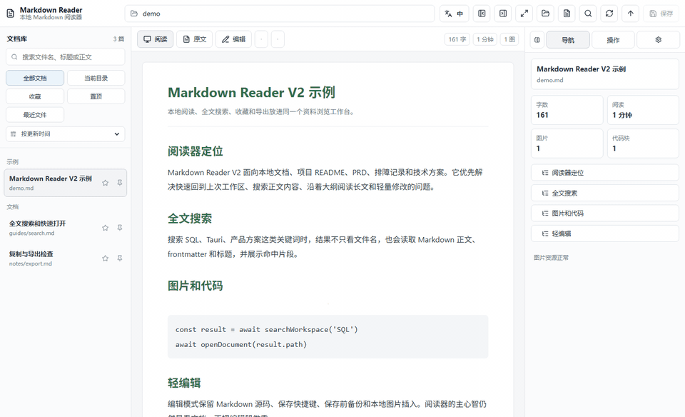
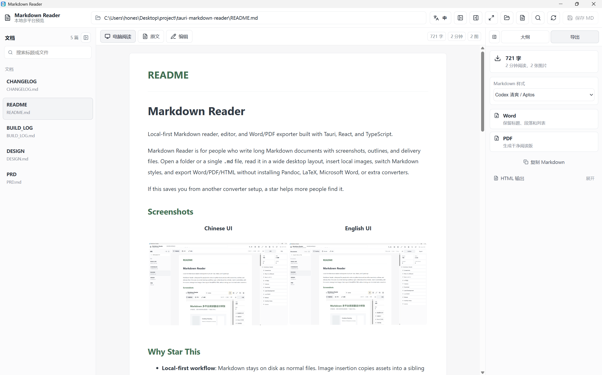
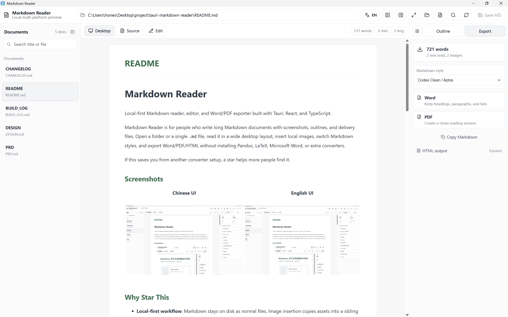

<div align="center">

<picture>
  <source media="(prefers-color-scheme: dark)" srcset="docs/assets/hero.zh-CN.svg">
  
</picture>

**让散落在项目里的 Markdown，成为好找、好读、好交付的文档。**

打开本地目录，搜索与阅读文档，进行轻量编辑，再导出 Word 或 PDF。文件留在磁盘上，工作围绕你的项目展开。

**适合谁：** 经常阅读 README、技术方案、产品文档与会议笔记的开发者和团队。

[下载应用](https://github.com/honestTai/tauri-markdown-reader/releases) · [GitHub](https://github.com/honestTai/tauri-markdown-reader) · [HRouter](https://hrouter.net/home)

**[快速开始](#-快速开始) · [功能](#-功能) · [文档](#-文档) · [License](#-license)**

[English](README.md) · **简体中文**

</div>

## ❤️ 赞助商

| 赞助商 | 简介 |
| :--- | :--- |
| [](https://hrouter.net/home) | **[HRouter](https://hrouter.net/home)**：面向 AI 编程与应用开发的模型接入、API Key 管理与用量统计，也由作者运营。 |

## 🚀 快速开始

发布包上传到 GitHub Releases：

[下载最新版本](https://github.com/honestTai/tauri-markdown-reader/releases/latest)

当前构建目标：

- Windows x64：NSIS `.exe` 安装包和 `.msi`
- macOS Apple Silicon / M 系列：`.app.tar.gz`

macOS 只发布 Apple Silicon / M 系列版本，不再支持 Intel 版安装包。如果 macOS 构建未经过 Apple 签名或公证，首次启动时可能需要在 Finder 中右键应用并选择“打开”。

### 本地开发

```bash
pnpm install
pnpm run tauri:dev
```

### 本地构建

```bash
pnpm run tauri:build
```

Windows 本地构建需要 Rust/Cargo 和 Microsoft C++ Build Tools。macOS 本地构建需要 Rust/Cargo、Xcode Command Line Tools 和 macOS 环境。

## ✨ 功能

| 功能 | 说明 |
| :--- | :--- |
| 资料库 | 打开目录或单个 Markdown 文件，自动递归扫描常见文档目录。快速打开、最近文件、收藏、置顶和每篇文档滚动位置记忆。 |
| 搜索 | 全文搜索文件名、标题、frontmatter 和正文片段。 |
| 阅读与编辑 | 阅读、编辑两种主视图；编辑模式就是 Markdown 源码视图，保存前自动备份。增加编辑历史面板，可预览和恢复保存前备份。增加文档锁定，锁定后可读但不能误保存、插图或恢复历史。 |
| 渲染 | 技术文档增强渲染：代码高亮、代码复制、KaTeX 公式、Mermaid 图表、GFM 表格和 GitHub 风格 callout。 |
| 编辑 | 编辑器支持选区快捷键，可快速插入加粗、链接、公式、表格、代码块和 Mermaid 图表。帮助窗口内置 Markdown 指南，点击即可在阅读区打开完整使用手册。 |
| 图片 | 本地图片插入、截图粘贴、图片拖入和缺失图片检查。 |
| 导入 | PDF 转 Markdown 草稿，适合可复制文本 PDF。DOCX 转 Markdown 草稿，尽量保留标题、列表、表格和图片。拖入文件夹、Markdown、PDF、DOCX 或图片时按类型自动处理。 |
| 导出 | 导出 Word、PDF、阅读 HTML，也支持复制 Markdown、纯文本和 HTML。 |
| CLI | GUI 安装包内置 `md-reader` CLI（Windows 为 `md-reader.exe`），可被系统终端、Codex 或其他 Agent 调用。 |
| 界面 | 中英文界面切换。 |
| 安全 | DOMPurify Markdown 净化、严格 CSP 和工作区文件范围限制。 |

V3 不再保留内置终端。真实终端在 Tauri WebView2/xterm 渲染链上不够稳定，后续 Agent/V4 会优先走外部 CLI。

## 📚 文档



| 中文界面 | 英文界面 |
| :--- | :--- |
|  |  |

中文宣传文案和素材路径见 [docs/PROMOTION.md](docs/PROMOTION.md)。

## 📄 License

本项目基于 MIT License 开源，详见 [LICENSE](LICENSE)。

## 📈 Star 历史

<a href="https://www.star-history.com/#honestTai/tauri-markdown-reader&Date">
  <picture>
    <source media="(prefers-color-scheme: dark)" srcset="https://api.star-history.com/svg?repos=honestTai/tauri-markdown-reader&type=Date&theme=dark">
    
  </picture>
</a>

---

<div align="center">

Made by **[honestTai](https://github.com/honestTai)** · [HRouter](https://hrouter.net/home) · [More projects](https://github.com/honestTai)

</div>
